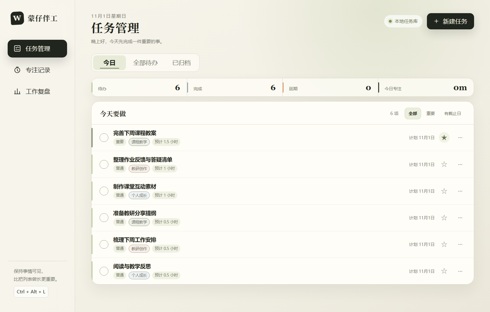
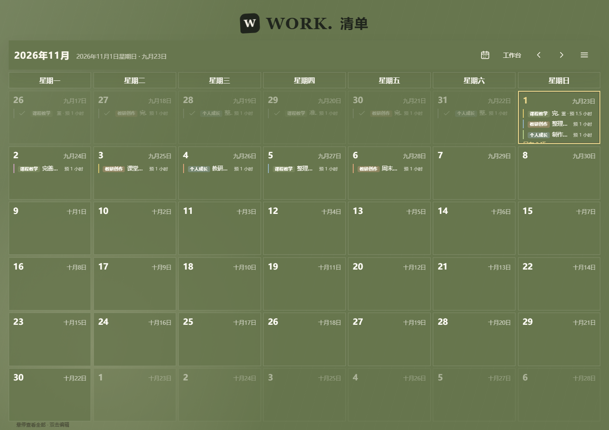
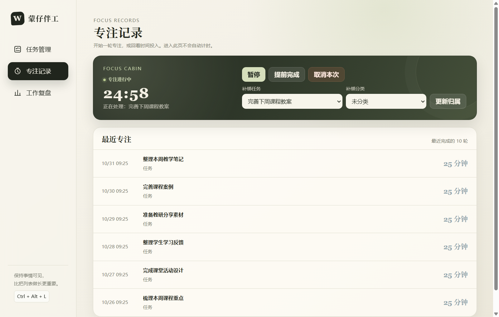
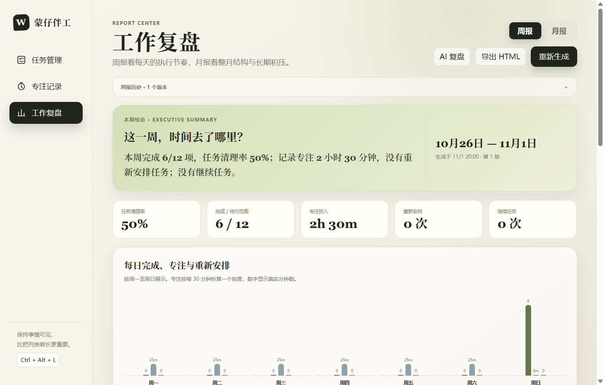

# 蒙仔伴工

把每天要做的事、桌面日历、专注计时和工作复盘放在一起的 Windows 个人效率工具。

适用于日常办公、个人事务管理及教学相关工作。你可以用它安排备课和教研，也可以管理写作、项目交付或自己的生活待办。

**当前公开版：0.4.4** · 本地保存数据 · 提供安装版与便携版

[**下载公开版**](https://github.com/SevenDamon/mengzaibangong-releases/releases/tag/v0.4.4) · [安装版（推荐）](https://github.com/SevenDamon/mengzaibangong-releases/releases/download/v0.4.4/Mengzai-WorkBench-Setup-0.4.4-x64.exe) · [便携版](https://github.com/SevenDamon/mengzaibangong-releases/releases/download/v0.4.4/Mengzai-WorkBench-0.4.4-x64.exe) · [SHA-256 校验](https://github.com/SevenDamon/mengzaibangong-releases/releases/download/v0.4.4/SHA256SUMS.txt)

> 本说明对应 0.4.4：基于 0.4.3，仅新增“关于”页的版权与使用说明。开发中的手机笔记、手机同步和灵感收件箱不属于本公开版。
>
> 下方截图直接取自 0.4.4 成品中的界面。任务、时间和统计全部为演示数据，不代表真实工作记录；日历外观可在软件设置中调整。

## 可以用它做什么

| 功能 | 具体用途 |
| --- | --- |
| 任务管理 | 安排日期、设置分类和重要性，记录预计与实际投入，完成后保留历史 |
| 桌面日历 | 在月历上查看任务、公历与农历，直接选日期新增或修改任务 |
| 专注记录 | 设置专注时长，暂停、继续或提前完成，查看时间投入并关联任务 |
| 工作复盘 | 从本地记录生成周报、月报，查看任务完成情况、分类投入和时间分布 |
| 快捷工作舱 | 点击桌宠或使用快捷键打开小窗口，快速录入和查询任务 |
| 可选 AI 与语音 | 配置自己的服务后，用文字或语音处理任务，主动发起 AI 复盘与规划 |

工作台、桌面日历、工作舱和桌宠使用同一套任务数据，不必在几个入口重复维护。

## 1. 任务管理：把今天要做的事放清楚

从“今日”开始查看当天安排，也可以切换“全部待办”和“已归档”。新建任务时填写名称与安排日期，再按需要补充分类、重要性、预计投入、截止日期或提醒。

完成任务后，可以补录实际用时和完成说明，供后续复盘使用。计划日期不会因为跨天自动后移；逾期任务通过每日复核，由你选择续排、重新安排到具体日期或完成归档。目标日期遇到同名或相近任务时，会提示比较与合并选择。



## 2. 桌面日历：直接在日期上安排工作

用月历查看任务分布，显示公历、农历、节日和节气。可以选日期新增、编辑任务，跨月定位日期，搜索任务标题、备注或分类。

日历支持独立调整外观，并提供 TXT、Excel、蒙仔数据库导出和系统打印；也支持导入兼容的蒙仔或 CalendarTask 数据库。覆盖导入前请先备份完整数据。



## 3. 专注记录：让投入的时间留下记录

设置一轮专注时长，可以关联具体任务或分类，也可以临时开始，之后再补充归属。支持暂停、继续和提前完成；结束后保留记录，方便查看时间投入。



## 4. 工作复盘：从记录生成周报与月报

本地周报、月报根据任务与专注事实生成，展示完成情况、时间投入、分类分布、改期和续排记录，并保留历史快照。未记录的数据会提示缺口，不会自动当成实际投入。

报告可以导出 HTML，任务清单可复制或导出 TXT、Excel。配置大模型后，可主动点击“AI 复盘”，先检查发送预览，再确认分析；AI 给出的计划是建议，写回任务前仍需要逐项核对和确认。



## 第一次使用

1. **下载安装。** 在 [Release 页面](https://github.com/SevenDamon/mengzaibangong-releases/releases/tag/v0.4.4)的 Assets 下载 EXE。一般用户选择安装版；希望免安装时可选便携版，下载后双击运行。GitHub 自动生成的 Source code 不是安装包。
2. **先建一条任务。** 从系统托盘打开工作台，点击“新建任务”，填写名称与安排日期。可以同时打开桌面日历，查看同一条任务。
3. **按需要启用专注。** 在“专注记录”中开始计时，结束后补充任务归属；需要时在“工作复盘”生成报告。
4. **最后再配置可选服务。** 在“设置 → 大模型”配置自己的模型服务；在“设置 → 语音”配置识别、朗读和麦克风并进行测试。管理任务、查看日历、专注计时和本地报表无需配置 AI。

点击桌宠或使用快捷键可以打开快捷工作舱。快捷键可在“设置 → 快捷键”中自定义，以软件当前显示为准。

## AI、语音、费用与数据

- **可选服务自行配置。** 安装包不附赠模型密钥、语音额度或第三方账号；相关用量和费用按所选服务商规则及本人账单承担。
- **按功能发送相关内容。** 使用联网 AI 或语音功能时，相关指令文本、任务上下文、报告数据或录音会按所选功能发送至配置的服务商。AI 复盘有发送预览，完成说明默认不勾选；确认前请检查内容。
- **AI 建议需要核实。** 任务修改、完成和取消等操作有确认流程。请结合实际核对识别结果、分析和计划，不把 AI 建议视为已经发生的工作事实。
- **保护好凭证与备份。** 不要公开 API Key、账号凭证或包含配置的完整备份；避免向第三方提供无权披露的信息。

## 如何完整备份

任务、专注记录、报告和设置等主要数据保存在本机：

```text
%APPDATA%\mengzai-workbench
```

升级、覆盖导入或迁移前，先正常退出蒙仔，再复制整个文件夹到安全位置。如果还保留旧测试版数据目录 `%APPDATA%\蒙仔伴工测试版`，也一并备份。

**TXT、Excel 和 HTML 导出用于阅读或整理，不等于完整备份。** 日历导出的蒙仔数据库用于恢复任务、分类等日历数据；完整迁移仍应保留整个软件数据目录。完整备份可能包含个人数据和服务配置，请妥善保存，不要直接上传到公开仓库。

## 版本与使用许可

本仓库仅提供公开版安装包、使用说明、校验文件与演示截图，不公开应用源码。

0.4.4 公开版可免费用于日常办公、个人事务管理及教学相关工作。未经书面授权，不得销售、收费分发本软件，去除署名后换牌分发，或将软件本身作为付费服务提供；上述限制不针对用户正常开展工作或教学活动。第三方代码、组件及素材按各自许可证或授权条款执行。

软件使用授权不默认包含终身更新、固定频率的功能更新、一对一安装配置或个性化定制服务。公开下载及会员渠道的版本、更新权益与配套服务，以下载或购买前已明确告知并约定的内容为准；已约定的权益不受减损。完整说明见软件“设置 → 关于 → 版权与使用说明”。

两种 EXE 均尚未代码签名，Windows 可能提示“未知发布者”。请核对本仓库来源与 SHA-256；已有用户升级前请退出旧版并备份数据。

© 2026 郑州市爱蒙斯教育科技有限责任公司。对本软件中依法享有权利的部分保留相应权利。产品开发：躬行者。
